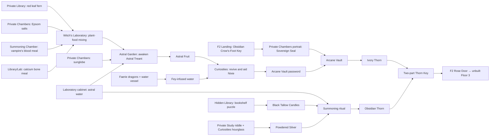

# Iggwilv's Tower — Campaign To-Do and GM Runbook

Source of truth: [Iggwilv's Tower Campaign Guide](C:/Users/rujie/Downloads/Iggwilv%E2%80%99s%20Tower%20Campaign%20Guide.pdf). The guide's room sequence, item placement, and puzzle dependencies take priority over the original topology sketches.

## Completed foundation

- [x] Produced eleven final-draft, gridless battle maps at 64 pixels per 5-foot square.
- [x] Installed every final map as an individual Foundry scene in **Into the Feywild** with the matching 5-foot grid, darkness, vision, fog, and exact scene dimensions.
- [x] Added the ten bidirectional internal tower routes as native Foundry Region teleports (twenty one-way thresholds / forty Regions including arrival zones).
- [x] Preserved the approved art direction: ornate Feywild witchcraft, Graz'zt's infernal influence, dense usable decor, and readable tactical space.
- [x] Kept map information selective: the laboratory cabinet is visibly a cabinet while its documented contents remain a discovery; map clutter does not reveal every reward.
- [x] Enabled the installed **Regionwright: Studio** module in **Into the Feywild**.
- [x] Prepared a reviewable, idempotent Regionwright setup macro for the guide's two explicit digital puzzles: [IGGWILV_TOWER_REGIONWRIGHT_MACROS.js](IGGWILV_TOWER_REGIONWRIGHT_MACROS.js).

## Campaign dependency flow

## Implement now in Foundry

These are deterministic installations from the guide. They do not require choosing an encounter system, an exact password, or player-facing dialogue.

- [ ] **Witch's Laboratory — Fey-Infused Plant Food.** Create a small interaction Region over the prepared workbench/cauldron, then run the supplied setup macro. It configures one measure each of `Red Leaf Fern`, `Epsom Salts`, `Blood Meal`, and `Calcium-Rich Bone Meal`. On success, award **Fey-Infused Plant Food** and mark the result in the GM log.
- [ ] **Hidden Library — enchanted bookcase.** Create an interaction Region over the relevant bookcase, then run the supplied setup macro. It configures a six-book Regionwright Spine Mosaic whose solution order is recorded in the macro. On success, reveal/award **Black Tallow Candles**.
- [ ] **F1 Landing / Private Study.** Add an interaction note to the wall-mounted removable star. The center of the landing must remain the shared spiral staircase; the star must not block the Private Chambers route. Place a matching note at the Study's star socket.
- [ ] **Private Study / Curiosities.** Add the statue's hourglass riddle and the Hourglass Coven object's concealed Powdered Silver compartment. Do not expose the compartment's contents in advance.
- [ ] **Private Study / Witch's Laboratory.** Add the Study-desk key clue and lock the reinforced laboratory cabinet. Its contents are Astral Water and a Demon Skull; reveal them only when opened.
- [ ] **Astral Garden.** Gate the Astral Treant scene behind its three visible activations: sunglobe, Astral Water, and Fey-Infused Plant Food. Award Astral Fruit only after the Treant encounter or negotiated resolution.
- [ ] **Curiosities.** Set the Nixie tank as a vertical sealed vessel containing a 2-foot desiccated Nixie. Water revives it; Astral Fruit secures cooperation; then it gives the vault password.
- [ ] **F2 Landing.** Put the Obsidian Crow's-Foot Key on its open display with the documented Flying Sword trap. It is conspicuous by design.
- [ ] **Private Chambers / Arcane Vault.** Make the crow-foot portrait socket yield the Sovereign Seal; require both that Seal and the Nixie's password at the vault.
- [ ] **Summoning Chamber.** Require Demon Skull + Black Tallow Candles + Powdered Silver before running the vampire-assisted Cambion summoning that yields the Obsidian Thorn.
- [ ] **F2 Rose Door.** Keep it locked until the Ivory and Obsidian Thorns form the Thorn Key. Its destination is Floor 3, which is intentionally outside this eleven-map package.

## GM content to prepare

- [ ] Choose the exact **Arcane Vault password**. The PDF says the Nixie gives it but deliberately does not prescribe the word.
- [ ] Choose system-appropriate stat blocks, token art, encounter difficulty, and treasure for: vampire assistant, milk skeletons, Flying Swords, Astral Treant, adult and child faerie dragons, Nixie, Cambion, Iggwilv, and Graz'zt.
- [ ] Write short discovery text for every named item, cabinet opening, portrait socket, statue answer, Nixie conversation, and each success/failure state.
- [ ] Decide whether the faerie dragons grant Fey-infused Water through roleplay, a favor, or an encounter; keep their water vessel/pool visible.
- [ ] Decide fail-forward handling for each puzzle: meaningful clue, cost, time pressure, or alternate path—never a dead end.
- [ ] Add sound, ambient lighting, and optional journal pins only after a table-side test; preserve map readability and the 5-foot grid.
- [ ] Design Floor 3 (Iggwilv's prison / Graz'zt confrontation) and its final teleport only when its map, encounters, and campaign stakes are approved.

## Per-room play checklist

| Room | Must be communicated or interactable | GM caution |
|---|---|---|
| F1 Landing | Wall star, shared two-floor spiral stair | Star is on wall; central floor belongs to stair. |
| Curiosities | Nixie tank, Hourglass Coven hourglass | Powdered Silver remains concealed in the hourglass. |
| Private Chambers | Sunglobe, Epsom-salt bath, portrait socket | Crow-foot mark is a clue, not a route blocker. |
| Private Library | Red Leaf Fern, calcium clue/source, Study route | Preserve the library-to-study connection. |
| Hidden Library | Enchanted bookcase and Black Tallow Candles | Bookshelf puzzle should have a discoverable visual order. |
| Private Study | Desk key, hourglass riddle/statue, star socket | The riddle answer is **HOURGLASS**. |
| Witch's Laboratory | Cabinet, mixing station, Astral Water/Demon Skull after unlock | Cabinet contents are not visually pre-spoiled. |
| F2 Landing | Obsidian Crow's-Foot Key and Flying Sword trap, rose door | Stair continues from F1; key is deliberately obvious. |
| Summoning Chamber | Vampire assistant / blood meal and ritual site | Cambion only follows complete ritual. |
| Astral Garden | Treant, faerie dragons, water source | Activate Treant only after all three inputs. |
| Arcane Vault | Seal/password gate and Ivory Thorn | Nixie password and Sovereign Seal are both required. |

## Test before play

- [ ] Start on F1 Landing with a disposable token and test every inward/outward tower teleport; ensure arrivals do not immediately bounce back.
- [ ] Test the full intended progression from the four ingredients through the Rose Door, plus at least one backtracking route.
- [ ] Confirm each scene remains `5 ft` per `64 px` grid square with the correct image dimensions.
- [ ] Confirm no player can read concealed cabinet/hourglass contents from a scene name, note label, or visible token.
- [ ] Run one player-perspective test for the two Regionwright puzzles and one GM reset test after a deliberate failure.

## Deferred by design

- [ ] Floor 3 map, confrontation, and prison escape: not in the supplied 11-map tower brief.
- [ ] Castle of Dreams exterior/hub connection: configure only after selecting the exact portal and arrival point in that separate scene.
